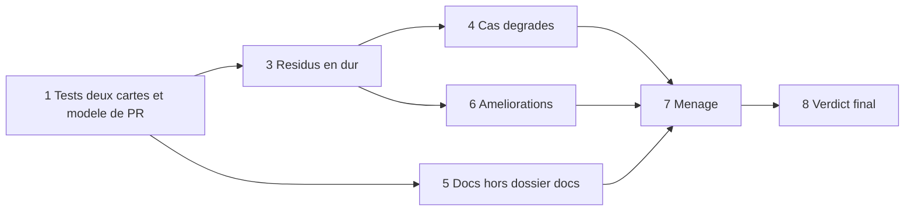

# Plan pour finir la refonte (hors déploiement)

> **Plan actif.** À lire en début de session avec [SUIVI.md](SUIVI.md) ; à mettre à jour en fin de session (cocher, noter la PR).
> Origine : [../verdict.md](../verdict.md) (vérification du 2026-10-19 sur `develop`, PR #21 à #39).
> Le plan historique des sessions 0 à 8 est dans [PLAN-SESSIONS.md](PLAN-SESSIONS.md) (workflow Git, décisions, détail des sessions faites).

## Décisions du propriétaire (2026-10-19)

- Les **tests automatisés « deux cartes »** (même code, deux configs) sont **remis** : leur retrait par la PR #38 était une erreur, c'est le filet principal de « 1 code, N cartes ». Le **modèle de PR** est remis avec eux.
- La **config Astek** (`app.config.astek.json`, `app.config.json` modifié localement, `app.config1.json`) était un essai local sans valeur : **supprimée**. La seconde config de référence est `docs/audit/fixtures/app.config.second-map.json`.
- **Hors de ce plan** : la session 8 (déploiement : config dans les images, `scripts/deploy.sh`, `docker build`) et le passage `develop` vers `main` avec tags.
- Périmètre : tout le reste du verdict (résidus en dur, cas dégradés, docs, améliorations du plan, ménage).

## Règles de travail (rappel)

- Début de session : `git status` propre, `git switch develop`, `git pull`, lire `AGENTS.md`, `SUIVI.md` et ce plan ; une branche courte par sujet, créée depuis `develop`.
- Une PR par branche, vers `develop` ; commits `type(scope): sujet` ; hook `husky` jamais contourné ; `pnpm build`, `pnpm lint` et `pnpm test` verts avant la PR ; **le merge est fait par le propriétaire** (« Create a merge commit »).
- Fin de session : tout est commité et poussé ; `SUIVI.md` et `JOURNAL.md` mis à jour (fait, preuves, prochaine étape) ; ce plan coché.
- Preuves : `fichier:ligne` ou commande exécutée ; sinon « non vérifié ».
- Prompt de démarrage : « Lis AGENTS.md, docs/audit/SUIVI.md et docs/audit/PLAN-FIN-REFONTE.md. Exécute uniquement l'étape N, applique le workflow Git de docs/audit/PLAN-SESSIONS.md, termine par le protocole de fin de session. »

## Ordre recommandé

L'étape 1 d'abord : les tests « deux cartes » servent de filet pour les étapes 3, 4 et 6. Les étapes 5 et 6 peuvent se faire en parallèle des étapes 3 et 4 (fichiers différents).

## Étapes

### 0. Mise en place du plan et nettoyage de `docs/` — fait (PR de cette session)

- [x] Verdict ajouté ([PR #40](https://github.com/AstekGroup/Rft-map-mecenat/pull/40), mergée).
- [x] Plan copié dans le dépôt (ce fichier), `PLAN-SESSIONS.md` mis à jour, `SUIVI.md` réécrit.
- [x] Docs obsolètes supprimées (photos du 2026-10-16 d'avant les correctifs : inventaire, lancement, validation, cartographie, branches, agents, plan de suite, synthèse, captures) ; `BASEROW-LOCAL.md` et `PERIMETRE-CONFIG-BASEROW.md` réécrits à l'état courant ; `JOURNAL.md` allégé de la phase d'audit.
- [x] **Config Astek supprimée** (étape 2 d'origine) : `git ls-files | rg -i astek` ne renvoie plus rien.

### 1. Remettre les tests « deux cartes » et le modèle de PR

Branche `test/retablir-deux-cartes`.

- [ ] Restaurer par `git revert` (un commit chacun) : `20df18a` (tests), `f4b14a8` et `425e487` (modèle de PR et `AGENTS.md`). Fichiers attendus : `apps/backend/src/config/deux-cartes.spec.ts` (origine `73431e7`), `apps/frontend/tests/deux-cartes.spec.tsx` (origine `dfdaa79`), `.github/pull_request_template.md` (origine `bab2417`).
- [ ] Vérifier que les tests passent avec le code actuel ; les adapter si le code a bougé, **sans affaiblir** les assertions.
- [ ] Vérifier la sensibilité par mutation (écrire temporairement un titre en dur, constater un test rouge, annuler).
- [ ] Ne comparer que la config du dépôt et `docs/audit/fixtures/app.config.second-map.json`.
- [ ] `AGENTS.md` : rétablir la phrase du modèle de PR (ligne 39) et la case « les tests deux cartes le font automatiquement » (ligne 47, qui dit aujourd'hui « pas de test automatisé »).
- [ ] Docs : `PLAN-SESSIONS.md` (retirer la décision « pas de test deux cartes » et la section « Retirer le test… », qui deviennent une note « annulé »), `SUIVI.md`, `JOURNAL.md`.
- Fait quand : `rg -i "deux-cartes|pull_request_template"` retrouve les trois fichiers et leurs références ; `pnpm test` vert.

### 3. Résidus en dur (verdict, écarts 4 et 5)

Branche `fix/residus-en-dur`.

- [ ] `apps/frontend/src/components/UI/Badge.tsx` (lignes 24-25, `#F2EDE4` et `#1F7A3E`) : passer par les variables de thème injectées par `ConfigProvider.tsx`.
- [ ] `apps/frontend/src/styles/globals.css` (ligne 11 et replis lignes 53-71) et `apps/frontend/tailwind.config.ts` (replis lignes 12-29) : palette neutre par défaut à la place de la palette LGSV.
- [ ] Le gris de repli `#D4DDE2`, dupliqué dans `HomePage.tsx`, `EventListView.tsx`, `EventCard.tsx`, `EventMarker.tsx` : utiliser `DEFAULT_FORMAT_COLOR` d'`utils/iconResolver.ts`.
- [ ] Étendre les tests « deux cartes » : le badge de format suit la couleur de thème de la seconde config.
- Fait quand : `rg -i "#[0-9a-f]{6}" apps/frontend/src --glob '!*.spec.*'` ne renvoie que la constante de repli neutre ; vérifié dans le navigateur avec la seconde config.

### 4. Cas dégradés restants (verdict, écart 6)

Branche `fix/cas-degrades-restants`.

- [ ] `MapPage.tsx` et `EventsListPage.tsx` : état d'erreur propre si `/api/config` échoue (comme l'accueil), sans badge vide ni clé brute.
- [ ] `EventDetailPage.tsx` (lignes 289-296) : masquer la section « Format » quand l'événement n'a pas de format (E15).
- [ ] Rendu de la page d'erreur de l'accueil sans thème (en partie réglé par la palette neutre de l'étape 3).
- [ ] Un test par cas.
- Fait quand : E15 et « config absente » s'affichent sans erreur ni texte vide, vérifié avec le seed.

### 5. Docs hors du dossier `docs/`

Branche `docs/alignement`. La partie `docs/` et les références cassées d'`AGENTS.md` sont faites à l'étape 0 ; reste :

- [ ] Neutraliser la marque dans `README.md`, `PROJECT_VIBE_CONF.md`, `apps/frontend/README.md`, `apps/backend/README.md` (« La Grande Semaine Végétale », « Design System LGSV », lien `resources/lgsv-design.yml`).
- [ ] `AGENTS.md` ligne 18 : retirer le paragraphe « Écart connu » une fois les étapes 3 et 4 mergées.
- Fait quand : `rg -i "lgsv|végétal|semaine" *.md apps/*/README.md` ne remonte que des exemples assumés.

### 6. Améliorations déjà planifiées

- [ ] Branche `refactor/filtre-modalite-carte` : retirer « Modalité » du panneau de la carte (`FilterDefinition.surfaces`, détail dans [PLAN-SESSIONS.md](PLAN-SESSIONS.md), section Améliorations). Annoncée par la description de la PR #38 mais **jamais faite**.
- [ ] Branche `feat/picto-kebab-case` : `getIcon` accepte `pen-tool` comme `PenTool`, nouveau `iconResolver.spec.ts`, mise à jour du « contrat du picto » dans `PERIMETRE-CONFIG-BASEROW.md`.

### 7. Ménage

Branche `chore/menage`.

- [ ] Supprimer `apps/frontend/src/App.tsx` (aucun import) et le test e2e périmé `apps/backend/test/app.e2e-spec.ts`.
- [ ] Les 3 avertissements du lint frontend (`MapView.tsx:79` et `:165`, `MapStyleSelector.tsx:12`) : corriger seulement si le comportement des hooks ne change pas, sinon les garder documentés.
- [ ] Supprimer les branches de travail mergées (locales et distantes, dont `wip/audit-snapshot`) : **liste donnée au propriétaire avant, aucune suppression sans son accord**. Les 3 branches obsolètes (`add-dynamic-filters`, `modify-audiences-filters`, `modif_audience_filters`) : accord de leur auteur d'abord.
- [ ] `scripts/seed-baserow/seed.mjs` : refuser toute URL non locale, comme le fait déjà `robustness.mjs` (garde-fou annoncé par la règle « Baserow en lecture seule »).
- [ ] Garde-fou optionnel contre le codé en dur : un test qui lance les recherches de la checklist d'`AGENTS.md` sur `apps/*/src` (à écarter s'il produit des faux positifs).

### 8. Verdict final

- [ ] Branche `docs/verdict-final` : rejouer `pnpm build`, `pnpm lint`, `pnpm run test -- --force` et les recherches du verdict sur `develop`, mettre à jour [../verdict.md](../verdict.md) et `SUIVI.md`. La session 8 et `develop` vers `main` restent « hors plan, non faits ».

## Vérification finale

- Depuis la racine : `pnpm build`, `pnpm lint`, `pnpm run test -- --force`, résultats notés dans `JOURNAL.md`.
- Navigateur avec le Baserow local et le seed : `APP_CONFIG_PATH=<chemin absolu de docs/audit/fixtures/app.config.second-map.json>` côté backend, puis retour à la config du dépôt ; titres, dates et couleurs changent sans toucher au code.
