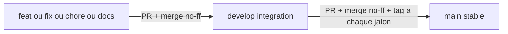

# Plan de refonte : workflow Git et 9 sessions

> **État au 2026-10-19** : sessions 0 à 7 faites (PR #9 à #39, toutes mergées dans `develop`), session 8 non faite. Le détail de l'état est dans [SUIVI.md](SUIVI.md), la vérification dans [../verdict.md](../verdict.md), **la suite dans [PLAN-FIN-REFONTE.md](PLAN-FIN-REFONTE.md)**. Ce fichier garde le workflow Git (toujours en vigueur), les décisions et l'historique des sessions.

## Le projet

- Dépôt : `https://github.com/AstekGroup/Rft-map-mecenat.git`. Monorepo pnpm 9 / Node 22 : `apps/frontend` (React, Vite, MapLibre), `apps/backend` (NestJS : proxy Baserow, géocodage BAN, cache), `shared/types` (`@make-map/types`, dont le type `AppConfig`).
- But : carte interactive d'événements, embarquée en iframe dans WordPress. Les visiteurs soumettent un événement par un formulaire, des modérateurs l'acceptent dans Baserow.
- Philosophie : **1 seul code pour N cartes**. Une carte = un fichier `app.config.json` (identité et titres, dates, design, correspondance avec le schéma Baserow) + les données dans **Baserow** (événements et référentiels avec couleurs, pictos, logos). Un changement de structure Baserow ne doit pas casser la carte. Le wording générique de l'interface reste en dur. Détail : [../../AGENTS.md](../../AGENTS.md) et [PERIMETRE-CONFIG-BASEROW.md](PERIMETRE-CONFIG-BASEROW.md).
- Origine : le projet avait été dupliqué 5 fois, les copies ont dérivé. La copie « avant refonte » JNR est dans `astek-jnr-map COMPARATIF/` (hors index git, à ne pas modifier ni commiter).

## Environnement local de test

- Baserow local jetable et jeu de test : [BASEROW-LOCAL.md](BASEROW-LOCAL.md).
- Backend : `pnpm back:dev` (port 3000). Frontend : `pnpm front:dev` (port 5173). Seconde config : `APP_CONFIG_PATH=<chemin absolu de docs/audit/fixtures/app.config.second-map.json>` côté backend.
- Les scripts de `scripts/seed-baserow/` écrivent dans Baserow : **uniquement** vers l'instance Docker locale.

## Règles non négociables

- Lire `AGENTS.md` de la zone modifiée. Interface en français ; code et identifiants peuvent rester en anglais.
- Aucun nom de champ Baserow ni titre de marque dans le code hors config. Pas de flags de fonctionnalités. Pas de `if (carte === …)`.
- Baserow : lecture seule depuis l'application ; jeton uniquement côté backend.
- Preuves : tout constat s'appuie sur un `fichier:ligne` ou une commande exécutée ; sinon « non vérifié ».
- Portée : changements ciblés, pas de refactor gratuit.

## Décisions prises

- **Textes** : les clés `texts.*` existantes (`meta`, `home`) restent dans la config ; le wording générique reste en dur.
- **Fonctionnalités** : aucun flag, on prend tout. Pas de filtre masquable par la config ; seuls les filtres Baserow vides se masquent seuls.
- **Airtable** : retiré partout (`AIRTABLE_*` remplacés par `BASEROW_*`). Aucune migration de données.
- **WordPress** : l'iframe reste telle quelle.
- **CLAUDE.md** : supprimé ; `AGENTS.md` est la seule source de consignes pour les agents.
- **Carte et régions** : restent dans le code.
- **Code mort** : supprimé (session 2).
- **Validation de la config au démarrage** : oui (session 4).
- **Filtres** : une seule définition pour la carte et la liste ; recherche multi-champs ; « pendant l'événement » = recoupement de la semaine ; événements passés visibles automatiquement une fois l'événement terminé ; un seul format par événement (avertissement dans les logs sinon) ; ordre des options = ordre des lignes Baserow ; hybride traité comme présentiel.
- **Événement sans date** : masqué partout, signalé dans les logs. **Fin avant début** : fin ignorée et journalisée. **Référentiel en erreur** : message dans les logs et dans `/api/health`, jamais confondu avec « vide ».
- **Pas de schéma cible Baserow** : la carte fonctionne avec le schéma indiqué par la config.
- **`index.html`** : métadonnées écrites à la compilation (une compilation par carte), script idempotent.
- **Tests « deux cartes » et modèle de PR** (décision du 2026-10-19) : ils avaient été retirés par la PR #38 (décision du 2026-10-18), le propriétaire a constaté que c'était une erreur : **ils sont remis** (étape 1 de [PLAN-FIN-REFONTE.md](PLAN-FIN-REFONTE.md)).
- **Config Astek** (2026-10-19) : essai local sans valeur, supprimée.
- **Hors plan actif** : session 8 (déploiement) et `develop` vers `main` avec tags.

## Workflow Git

- `main` : stable, jamais de commit direct, mis à jour seulement depuis `develop` par PR, avec un tag à chaque jalon.
- `develop` : branche d'intégration. Branches de travail courtes, créées depuis `develop`, une par sujet, supprimées après merge. Noms en `kebab-case` avec préfixe de type (`feat/`, `fix/`, `refactor/`, `chore/`, `docs/`, `test/`), sans doublon.
- Commits : un commit = un changement logique dont les tests passent. Format Conventional Commits `type(scope): sujet`, type en anglais, sujet court en français à l'impératif, 72 caractères maximum. Scopes : `front`, `back`, `types`, `config`, `docs`, `deploy`, `scripts`. Le hook `husky` lance `pnpm test` à chaque commit ; jamais `--no-verify`. Pas de commit « wip », « fix » ou « update ».
- PR : une par branche de travail, vers `develop`, petite et lisible (une idée, idéalement moins de 400 lignes de diff hors docs). `git rebase develop` avant la PR. Merge par **merge commit** (`--no-ff`). Pas de force-push sur `main` ni `develop` ; `--force-with-lease` seulement sur sa propre branche. Branche supprimée (locale et distante) après le merge. Aucune PR n'est mergée avec des tests rouges.
- `gh` est installé et authentifié : les sessions ouvrent elles-mêmes les PR (`gh pr create --base develop`, description : objectif, changements, tests exécutés). **Le merge est fait par le propriétaire**, sauf demande explicite. Sur cette machine `gh` n'est pas dans le `PATH` du terminal : `C:\Program Files\GitHub CLI\gh.exe`.
- Fins de ligne : `.gitattributes` (`* text=auto eol=lf`), `core.autocrlf=true` en local.
- À régler sur GitHub par le propriétaire : protéger `main` et `develop` (PR obligatoire, pas de push direct) : non vérifié.

## Protocole de session

- **Début** : `git status` propre (sinon s'arrêter et le dire) ; `git switch develop` puis `git pull` ; lire `AGENTS.md`, `SUIVI.md` et la fiche de l'étape ; créer la branche.
- **Fin** : tout commité et poussé ; PR ouverte ; `SUIVI.md` et `JOURNAL.md` à jour (fait, preuves, prochaine étape) ; `pnpm build`, `pnpm lint`, `pnpm test` exécutés et résultat noté.
- Les sessions 3 et 4 touchent toutes deux `app.config.json` et le type `AppConfig` : à faire l'une après l'autre.

## Sessions

### Session 0 : GitHub CLI — faite

`gh` 2.102.0 installé par `winget`, connecté (compte `ClementTro`, droit ADMIN sur le dépôt). Preuves : JOURNAL.

### Session 1 : base Git — faite (PR #9 à #14)

`.gitattributes` (#9), types du front corrigés pour que `pnpm build` passe (#10), `devMode` fermé hors développement et modération fail-closed (#11), Baserow local et seed (#12), docs d'audit (#13), lockfile resynchronisé et `package-lock.json` supprimé (#14). `develop` créée depuis `main`. Reste au propriétaire : `develop` vers `main` et tag `v0.1.0` (hors plan actif).

### Session 2 : nettoyage et intégration — faite (PR #21 ; #15 à #20 fermées au profit de #21)

`CLAUDE.md` supprimé, `AGENTS.md` réécrits, Airtable retiré, code mort supprimé (`Header`, `Footer`, `mockEvents`, scripts morts), branches `Refonte-Unifier-les-outils-de-la-carte-MAP` et `Refonte-Unification-du-panneau-latéral` fusionnées (auteur conservé), recherche multi-champs rétablie. Restent : suppression des 3 branches obsolètes (accord de l'auteur, étape 7 du plan actif).

### Session 3 : titres et identité pilotés par la config — faite (PR #22, #23, #24)

Gabarits `{{app.name}}` (nom écrit une fois), badge d'édition et libellés de période depuis la config, plus de repli de dates, `index.html` généré de façon idempotente depuis `index.template.html`.

### Session 4 : Baserow réglable par la config, config validée — faite (PR #25, #26, #27, #28)

`AppConfig` aligné sur ce qui est lu ; 29 replis de noms de colonnes supprimés ; colonnes de référence, valeurs de modalité, tarif gratuit et modération lus dans `baserow.mapping` et `baserow.moderationVisibleValue` ; config validée au démarrage (le backend refuse de démarrer avec la liste des erreurs) ; schéma Baserow comparé à la config au démarrage et à chaque chargement ; seed adapté (`--config`).

### Session 5 : filtres — faite (PR #29, #30, #31)

Une seule définition des filtres (`FILTER_DEFINITIONS`) pour le panneau de la carte et la barre de la liste ; recherche multi-champs, recoupement de la semaine, passés visibles automatiquement après l'événement, un seul format avec avertissement, ordre Baserow, référentiel en erreur distinct d'un référentiel vide (502 et `/api/health` `degraded`).

### Session 6 : cas dégradés — faite (PR #32)

Événement sans date masqué et journalisé, fin avant début ignorée, capacité numérique, date lue à Paris (E27), plus d'`Invalid Date`, accueil avec état d'erreur et plus de clé brute, délai de modération documenté (cache de 5 minutes ou redémarrage).

### Session 7 : qualité — faite (PR #33 à #36, puis #38)

ESLint frontend (0 erreur, 3 avertissements connus), lint backend sans `--fix`, `pnpm test` couvre `shared/types`, `VITE_MAPTILER_KEY` retirée (#33). Tests « deux cartes » (#34) et modèle de PR (#35) ajoutés, puis **retirés par la PR #38, retrait annulé le 2026-10-19** (voir Décisions). La description de la PR #38 annonçait aussi le retrait du filtre Modalité de la carte : non fait dans #38, **fait ensuite par la PR #46** (voir Améliorations).

### Session 8 : déploiement — non faite, hors du plan actif

Fournir `app.config.json` aux images Docker, corriger ou supprimer `scripts/deploy.sh` (il vise `apps/map-interactive/dist`, dossier inexistant), lancer un vrai `docker build` puis `compose up`, vérifier les variables `BASEROW_*`. Aucun travail sur WordPress. Fait quand : l'application démarre depuis les images et sert une carte.

## Hors plan (faits)

- PR #37 : seed Baserow à 1000 événements (`--total=N`).
- PR #39 : le test des métas ne dépend plus du wording de la carte.
- PR #40 : verdict.

## Améliorations (faites à l'étape 6 de PLAN-FIN-REFONTE.md, PR #46 et #47 ; spécification conservée ici)

Deux changements du frontend, indépendants : une branche courte et une PR chacun.

### Picto : accepter le nom Lucide copié depuis lucide.dev

- Constat : la colonne `Picto` des tables de référence est lue telle quelle par le backend (`firstSelectValue`, `apps/backend/src/baserow/baserow-mapping.util.ts`), puis cherchée dans `lucide-react` par `getIcon` (`apps/frontend/src/utils/iconResolver.ts`). lucide.dev donne le nom en kebab-case (`pen-tool`), alors que `lucide-react` exporte `PenTool` : une valeur copiée depuis le site tombe sur l'icône par défaut, sans message.
- Branche `feat/picto-kebab-case` (frontend uniquement) : `getIcon` essaie d'abord le nom tel quel, puis sa conversion kebab-case vers PascalCase (`pen-tool` donne `PenTool`, `arrow-down-0-1` donne `ArrowDown01`) ; espaces en début et fin ignorés ; nom inconnu ou vide : repli inchangé. Nouveau `iconResolver.spec.ts` (PascalCase, kebab-case, chiffres, espaces, inconnu, vide). Docs : « contrat du picto » de `PERIMETRE-CONFIG-BASEROW.md` et `apps/frontend/AGENTS.md`.
- Fait quand : `pen-tool` et `PenTool` donnent la même icône, vérifié sur la table Formats du Baserow local.

### Carte : retirer le filtre « Modalité »

- Constat : les événements en ligne n'ont pas de coordonnées et sont exclus de la carte (`eventsToGeoJSON`, `apps/frontend/src/services/api.ts`), « hybride » est rabattu sur présentiel : sur la carte, ce filtre n'a pas d'effet utile. La carte a déjà un bouton « Événements en ligne » vers `/evenements?modality=distanciel` (`MapPage.tsx`).
- Contrainte : règle 6 de `apps/frontend/AGENTS.md` : **une seule définition des filtres**, sans second tableau.
- Branche `refactor/filtre-modalite-carte` : dans `utils/filterDefinitions.ts`, type `FilterSurface = 'panel' | 'bar'`, champ optionnel `surfaces?: readonly FilterSurface[]` (absent = partout), `surfaces: ['bar']` sur `modality` ; `getVisibleFilters` et `getVisibleFiltersFor` reçoivent la surface ; `FilterPanel` passe `'panel'`, `EventFiltersBar` passe `'bar'`. Tests : adapter `filtresUnifies.spec.tsx` et ajouter « le panneau n'affiche pas Modalité, la barre l'affiche ». Docs : règle 6 de `apps/frontend/AGENTS.md`.
- Fait quand : sur `/carte`, plus d'accordéon « Modalité » et le bouton « Événements en ligne » mène toujours à la liste filtrée ; sur `/evenements`, le filtre Modalité est toujours là.

## Explicitement hors du plan

- Flags de fonctionnalités et activation déduite des données.
- Réintégration des fonctions de JNR et des 4 autres copies.
- Sélection de profil côté front et plusieurs cartes dans un même déploiement.
- Restriction `frame-ancestors` côté Caddy.
