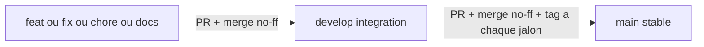

# Plan refonte : workflow Git propre et 9 sessions IA

Ce fichier est **autonome** : une IA qui n'a pas vu la conversation d'origine doit pouvoir l'exécuter avec lui et avec les fichiers du dépôt. Chemin de ce fichier : `C:\Users\ctrofleau\.cursor\plans\plan_refonte_en_6_étapes_e134e090.plan.md` (le nom du fichier garde l'ancien titre ; il est hors dépôt, la session 1 en copie le contenu dans `docs/audit/PLAN-SESSIONS.md`).

## Contexte pour une session sans historique

### Le projet

- Dépôt : `C:\Users\ctrofleau\Documents\Rft-map-mecenat` (remote `origin` : `https://github.com/AstekGroup/Rft-map-mecenat.git`). Monorepo pnpm 9 / Node 22 : `apps/frontend` (React, Vite, MapLibre), `apps/backend` (NestJS : proxy Baserow, géocodage BAN, cache), `shared/types` (`@make-map/types`, dont le type `AppConfig`).
- But : application de carte interactive d'événements (aujourd'hui La Grande Semaine Végétale, bientôt Les Journées de la Réparation), embarquée en iframe dans WordPress. Les visiteurs soumettent un événement via un formulaire, des modérateurs l'acceptent dans Baserow.
- Philosophie de la refonte : **1 seul code pour N cartes**. Une carte = un fichier `app.config.json` (identité et titres, dates, design, correspondance avec le schéma Baserow) + les données dans **Baserow** (événements et référentiels : formats, publics, thématiques, partenaires, avec couleurs, pictos, logos). Un changement de structure Baserow ne doit pas casser la carte. Le wording générique de l'interface reste en dur.
- Origine : le projet avait été dupliqué 5 fois (une copie par événement), les copies ont dérivé. La refonte (Airtable vers Baserow, config par carte) a été faite en partie par un développeur indisponible. La copie « avant refonte » JNR est dans `astek-jnr-map COMPARATIF/` (hors index git, à ne pas modifier ni commiter).

### Ce que l'audit a établi (documents dans `docs/audit/`, à relire au besoin)

- Fichiers à connaître : `SUIVI.md` (état), `JOURNAL.md` (commandes et preuves), `SYNTHESE.md` (vue d'ensemble), `08-perimetre-config-vs-baserow.md` (qui gère quoi : config, Baserow, code, env ; analyse des filtres), `04-cartographie.md` (codé en dur avec `fichier:ligne`), `03-validation.md` (bugs prouvés), `02-baserow-seed.md` (Baserow local et jeu de test), `07-plan-de-suite.md` (ancien backlog, **périmé sur plusieurs points** : voir sa note de révision), `06-agents.md` (réécriture des `AGENTS.md`).
- Le projet **fonctionne** : 127 tests verts (backend 69, frontend 58), `pnpm build` passe après correction, carte, clusters, filtres, DOM-TOM et iframe vérifiés sur 1 536 événements de test.
- Limites connues : le lint frontend n'est pas configuré ; le lint backend utilise `--fix` et remonte 2 051 faux positifs de fin de ligne ; `pnpm test` ne couvre pas `shared/types` ; le `Dockerfile` n'embarque pas `app.config.json` ; aucun `docker build` n'a jamais été lancé.
- Rappel des écarts à la philosophie à corriger (par session) : titres de marque en dur (`EventListView.tsx:88,108` « LGSV 2026 », `FilterPanel.tsx:49` et `EventFiltersBar.tsx:89,128` libellés de repli, nom de l'événement répété 7 fois dans `app.config.json`) ; 29 noms de champs de repli (`baserow.service.ts:289-390`, `fm.x || '...'`) ; colonnes des tables de référence en dur (`baserow.service.ts:165-173`) ; valeurs de listes de choix en dur (`baserow-mapping.util.ts:8-12`, `baserow.service.ts:236,389`) alors que `baserow.mapping` existe en type sans être dans le JSON ni lu (`mm`, `baserow.service.ts:278`) ; repli de dates trompeur (`baserow-mapping.util.ts:72-73`) ; une seule valeur de format retenue (`baserow.service.ts:360`) ; tri alphabétique des options (`baserow.service.ts:115`) ; une table de référence en erreur renvoie une liste vide (`baserow.service.ts:193`) ; `index.html` écrit à la compilation par `apps/frontend/scripts/update-index-html.cjs` (non idempotent) ; aucune validation de la config au démarrage.
- Cas de test utiles dans le jeu de données (`scripts/seed-baserow/seed.mjs`) : `E15` sans format, `E16` sans date, `E17` sans titre, `E26` fin avant début, `E27` fuseau, `E13` adresse invalide, `E28`/`E29` picto ou couleur invalides.

### Environnement local de test

- Baserow local jetable : `docker compose -f deploy/baserow-local/docker-compose.yml up -d`, puis `node scripts/seed-baserow/seed.mjs` (1000 événements au total par défaut) (écrit `apps/backend/.env`, gitignoré). Procédure, comptes et réinitialisation : `docs/audit/02-baserow-seed.md`. Ces fichiers sont dans l'arbre de travail non commité tant que la session 1 n'est pas faite.
- Backend : `pnpm back:dev` (port 3000). Frontend : `pnpm front:dev` (port 5173). Pour une 2ᵉ config : variable `APP_CONFIG_PATH=docs/audit/fixtures/app.config.second-map.json` côté backend.
- Les scripts de `scripts/seed-baserow/` écrivent dans Baserow : **uniquement** vers l'instance Docker locale, jamais vers un vrai Baserow.

### État Git de départ (vérifié le 2026-10-16)

- Branche courante `audit/bilan-refonte`, **au même commit que `main` (`114aeb3`)**. **Rien n'est commité** : 14 fichiers modifiés (`AGENTS.md` ×5 dont racine, backend, frontend, `shared/types`, `deploy` ; `apps/backend/.env.example` ; `baserow.service.ts` ; `events.controller.ts` et son spec ; `MapPage.tsx`, `EventsListPage.tsx`, `types/event.ts` ; `pnpm-lock.yaml`), `DEVPLAN.md` supprimé, et en non suivi : `apps/backend/src/baserow/baserow.service.spec.ts`, `deploy/baserow-local/`, `docs/`, `scripts/seed-baserow/`.
- **Ne jamais utiliser** `git checkout -- .`, `git reset --hard`, `git clean`, ni changer de branche en écrasant l'arbre de travail avant la sauvegarde de la session 1.
- Config git : `core.autocrlf=true`, index en LF, pas de `.gitattributes`. Identité : `ctrofleau` / `clement.trofleau@astek.net`. Le hook `husky` (`.husky/pre-commit`) lance `pnpm test` à chaque commit.
- Branches distantes : `Refonte-Unification-du-panneau-latéral` et `Refonte-Unifier-les-outils-de-la-carte-MAP` (1 commit chacun, auteur M. Perrot, à merger) ; `add-dynamic-filters`, `modify-audiences-filters`, `modif_audience_filters` (obsolètes, leur contenu est déjà dans `main`).
- Le CLI `gh` n'est pas installé ; `winget` est disponible.

### Règles non négociables pour toutes les sessions

- Lire `AGENTS.md` de la zone modifiée. Répondre et écrire en français pour l'interface ; code et identifiants peuvent rester en anglais.
- Aucun nom de champ Baserow ni titre de marque dans le code hors config. Pas de flags de fonctionnalités. Pas de `if (carte === …)`.
- Baserow : lecture seule depuis l'application ; jeton uniquement côté backend.
- Preuves : tout constat s'appuie sur un `fichier:ligne` ou une commande exécutée ; sinon écrire « non vérifié ».
- Portée : changements ciblés, pas de refactor gratuit hors de la session.

## Décisions prises

- **Textes** : les clés `texts.*` existantes (meta, home) restent dans la config ; le wording générique (boutons, placeholders) reste en dur.
- **Fonctionnalités** : aucun flag, on prend tout. Pas de filtre masquable par la config ; seuls les filtres Baserow vides se masquent seuls, comme aujourd'hui.
- **Airtable** : retiré partout, y compris les fichiers de déploiement (`AIRTABLE_*` remplacés par `BASEROW_*`, sans test de déploiement). Aucune migration de données.
- **WordPress** : l'iframe reste telle quelle. Le point A7 est abandonné.
- **CLAUDE.md** : supprimé. `AGENTS.md` devient la seule source.
- **Carte et régions** : restent dans le code.
- **Code mort** : supprimé dans ce plan (session 2).
- **Branches** : on merge les 2 branches `Refonte-*` (seul dev utile ; les 3 autres sont déjà dans `main`).
- **Couleur `primary`** : sans importance (le fichier du dépôt est un fichier de dev/test).
- **Validation de la config au démarrage (B2)** : oui.
- **Filtres** :
  - unifier les deux interfaces (carte et liste) autour d'une définition unique ;
  - recherche multi-champs (titre, description, ville, organisateur, région, lieu) ;
  - « pendant l'événement » = tout événement qui recoupe la semaine ;
  - événements passés affichés automatiquement une fois l'événement terminé ;
  - un seul format par événement (avertissement dans les logs s'il y en a plusieurs) ;
  - ordre des options = ordre des lignes dans Baserow ;
  - hybride traité comme présentiel (inchangé).
- **Événement sans date** : masqué partout, signalé dans les logs.
- **Pas de schéma cible Baserow** : la carte doit fonctionner avec le schéma indiqué par la config.

Choix par défaut proposés (à corriger si besoin) : fin avant début = date de fin ignorée et journalisée ; table de référence en erreur = message clair dans les logs et la santé de l'API (pas de masquage silencieux) ; `index.html` = métadonnées écrites à la compilation, script rendu fiable et documenté.

## Workflow Git

### Branches

- `main` : stable, jamais de commit direct, mis à jour seulement depuis `develop` par PR, avec un tag à chaque jalon.
- `develop` : branche d'intégration, créée depuis `main` (elle pointe aujourd'hui sur le même commit `114aeb3`).
- Branches de travail courtes, créées depuis `develop`, une par sujet, supprimées après merge. Noms en `kebab-case`, préfixés par le type : `feat/…`, `fix/…`, `refactor/…`, `chore/…`, `docs/…`, `test/…`. Aucun doublon de nom.
- Cas des 2 branches `Refonte-*` (auteur M. Perrot) : on fusionne les branches elles-mêmes pour garder l'auteur et l'historique (voir session 2).

### Commits

- Un commit = un changement logique, qui compile et dont les tests passent. Le hook `husky` lance `pnpm test` à chaque commit ; on n'utilise jamais `--no-verify`.
- Format Conventional Commits : `type(scope): sujet`, type en anglais (`feat`, `fix`, `refactor`, `docs`, `chore`, `test`), sujet court en français à l'impératif, 72 caractères maximum. Scopes : `front`, `back`, `types`, `config`, `docs`, `deploy`, `scripts`.
- Exemples : `fix(front): retirer les types supprimés de @make-map/types`, `fix(back): refuser la publication sans champ de modération`, `chore(scripts): ajouter le seed Baserow local`.
- Pas de commit « wip », « fix » ou « update ». Pas de fichiers sans rapport avec le commit.

### Merges et PR

- Une PR par branche de travail, vers `develop`. Petite et lisible (une idée, idéalement moins de 400 lignes de diff hors docs).
- Avant la PR : `git rebase develop` sur la branche de travail pour un historique linéaire, puis tests verts.
- Merge dans `develop` par **merge commit** (`--no-ff`) : les commits atomiques sont conservés et chaque PR reste un groupe visible dans l'historique.
- Pas de force-push sur `main` ni `develop`. Sur sa propre branche, `--force-with-lease` seulement.
- Suppression de la branche (locale et distante) après le merge.
- Aucune PR n'est mergée avec des tests rouges. Checklist de PR de `AGENTS.md`.
- Réglage à faire sur GitHub (par toi, je n'y ai pas accès) : protéger `main` et `develop` (PR obligatoire, pas de push direct).
- `gh` est installé et authentifié en session 0 : les sessions ouvrent elles-mêmes les PR (`gh pr create --base develop`, titre au format Conventional Commits, description : objectif, changements, tests exécutés). **Le merge reste fait par le propriétaire** (bouton « Merge pull request » sur GitHub, option « Create a merge commit »), sauf s'il demande explicitement à la session de merger. Mode dégradé sans `gh` : la session pousse la branche et donne le lien renvoyé par `git push`.

### Fins de ligne

- Le dépôt a `core.autocrlf=true` et pas de `.gitattributes`. L'index est déjà en LF (107 fichiers vérifiés `i/lf`, aucun `i/crlf` dans `apps` et `shared`). Ajouter un `.gitattributes` (`* text=auto eol=lf`) ne crée donc pas de gros commit de renormalisation ; il sert à garder des diffs propres. C'est le tout premier commit sur `develop`.

## Découpage en sessions IA

### Principe

Chaque session est autonome : une IA qui n'a jamais vu la conversation doit pouvoir l'exécuter avec la fiche de session et les fichiers du dépôt.

- **Mémoire entre sessions** : au début de la session 1, ce plan est copié dans le dépôt sous `docs/audit/PLAN-SESSIONS.md` (le fichier du plan est hors dépôt). `docs/audit/SUIVI.md` reste le journal d'état, `docs/audit/JOURNAL.md` les preuves.
- **Début de session** : (1) `git status` doit être propre, sinon s'arrêter et le dire (exceptions : sessions 0 et 1, voir leur fiche) ; (2) `git switch develop` puis `git pull` ; (3) lire `AGENTS.md`, `docs/audit/SUIVI.md` et la fiche de la session ; (4) créer les branches de la fiche. Tant que la session 1 n'est pas faite, la fiche se lit dans le fichier de plan hors dépôt (chemin en tête de ce document).
- **Fin de session** : tout est commité et poussé (jamais de travail non commité entre deux sessions) ; branches rebasées et PR prêtes (ou mergées si tu as validé) ; `SUIVI.md` et `JOURNAL.md` mis à jour (ce qui est fait, preuves, prochaine session) ; `pnpm build`, `pnpm lint` et `pnpm test` exécutés, résultat noté (avec les limites connues).
- **Prompt de démarrage pour les sessions 0 et 1** (le plan n'est pas encore dans le dépôt) : « Lis C:\Users\ctrofleau\.cursor\plans\plan_refonte_en_6_étapes_e134e090.plan.md en entier, puis exécute uniquement la Session 0 (ou 1) en respectant le workflow Git et le protocole de fin de session. Ne fais rien d'autre. »
- **Prompt de démarrage pour les sessions 2 à 8** : « Lis AGENTS.md, docs/audit/SUIVI.md et la section de la Session N dans docs/audit/PLAN-SESSIONS.md (en cas de doute sur le contexte, lis aussi docs/audit/SYNTHESE.md et 08-perimetre-config-vs-baserow.md). Applique le workflow Git de ce fichier. Exécute uniquement la Session N, ne fais rien d'autre, et termine par le protocole de fin de session. »
- **Ordre** : sessions 0 à 8 dans l'ordre ; les sessions 3 et 4 touchent toutes deux `app.config.json` et le type `AppConfig` : à faire l'une après l'autre. La session 6 peut s'insérer après la session 4. Les sessions 7 et 8 viennent en dernier.

### Session 0 : GitHub CLI (`gh`)

Objectif : permettre à l'agent de pousser des branches et d'ouvrir des PR sans clic manuel. Aucun changement dans le dépôt.

- Vérifier : `gh --version` (absent au 2026-10-16), `winget --version` (présent).
- Installer : `winget install --id GitHub.cli -e`. Rouvrir le terminal si `gh` n'est pas reconnu après l'installation (le PATH n'est pas rechargé dans une session de terminal déjà ouverte).
- **Étape à faire par le propriétaire** (l'agent ne peut pas la faire) : `gh auth login` (GitHub.com, HTTPS, connexion par navigateur). Si l'organisation AstekGroup impose le SSO, autoriser le jeton pour l'organisation. Alternative : définir une variable d'environnement `GH_TOKEN` avec un jeton ayant le droit `repo`.
- Vérifier : `gh auth status` ; `gh repo view AstekGroup/Rft-map-mecenat` ; droit de push (le premier `git push` d'une branche réelle sert de test en session 1) ; `gh pr list` (liste aussi les PR ouvertes sur les branches distantes, ce que l'audit n'avait pas pu vérifier).
- Si `gh` ne peut pas être authentifié : le plan reste valable en mode dégradé : l'agent pousse la branche et affiche le lien de PR renvoyé par `git push` ; le propriétaire clique sur « Merge ».
- Fait quand : `gh auth status` indique une connexion valide sur `github.com` pour le compte du propriétaire.

### Session 1 : base Git et corrections déjà faites

Objectif : sortir tout le travail de l'audit de l'arbre de travail en commits propres sur `develop`.

Situation de départ vérifiée : branche `audit/bilan-refonte` au même commit que `main` (`114aeb3`), tout le travail est non commité (14 fichiers modifiés, `docs/`, `scripts/seed-baserow/`, `deploy/baserow-local/`, `apps/backend/src/baserow/baserow.service.spec.ts` en non suivi).

- Sauvegarder d'abord l'arbre de travail dans un commit unique sur une branche temporaire `wip/audit-snapshot` (poussée comme sauvegarde), puis créer `develop` depuis `main` et la pousser.
- Branche `chore/gitattributes` : `.gitattributes` (`* text=auto eol=lf`).
- Branche `fix/build-types` : commit `fix(front): retirer les types supprimés de @make-map/types` (`types/event.ts`, `MapPage.tsx`, `EventsListPage.tsx`).
- Branche `fix/moderation-devmode` : deux commits distincts, `fix(back): fermer devMode hors développement` (`events.controller.ts`, son spec, `.env.example`) et `fix(back): refuser la publication sans champ de modération` (`baserow.service.ts`, `baserow.service.spec.ts`).
- Branche `chore/baserow-local` : `chore(deploy): ajouter le Baserow local jetable` (`deploy/baserow-local/`) et `chore(scripts): ajouter le seed Baserow local` (`scripts/seed-baserow/`). À merger après `fix/moderation-devmode` (le seed écrit `ALLOW_DEV_MODE`).
- Branche `docs/audit-refonte` : `docs(audit): ajouter le bilan de la refonte` (`docs/audit/` y compris les 5 captures, 1,8 Mo en tout : choix par défaut, à retirer si le propriétaire préfère ; sans `06-agents.diff` devenu obsolète), `docs(audit): ajouter le plan de sessions` (copie du plan dans `docs/audit/PLAN-SESSIONS.md`) et `docs: supprimer DEVPLAN.md obsolète`. Les documents d'audit ne sont **pas** réécrits : ce sont des photos datées du 2026-10-16 ; `07-plan-de-suite.md`, `SYNTHESE.md` et `08-perimetre-config-vs-baserow.md` signalent déjà les points périmés.
- Branche `chore/lockfile` : `chore: resynchroniser pnpm-lock.yaml` ; supprimer `package-lock.json` (suivi par git alors que le projet utilise pnpm ; à confirmer à la revue).
- Les 5 `AGENTS.md` modifiés ne sont **pas** commités ici : ils sont repris en session 2 selon les décisions.
- Vérifier que le dossier JNR (`astek-jnr-map COMPARATIF/`) reste hors de l'index (il n'apparaît pas dans `git status` ; non vérifié pourquoi).
- Méthode : pour chaque branche, partir de `develop` et récupérer les fichiers du snapshot avec `git checkout wip/audit-snapshot -- <chemins>`, puis commiter par groupe logique.
- Avant tout : exécuter la sauvegarde `wip/audit-snapshot` (voir le premier point) et la pousser, puis seulement commencer le découpage. Cette session démarre avec un arbre de travail **non propre** (c'est le but) : ne rien supprimer ni réinitialiser.
- Le premier `git push` de la session sert de test de droit d'écriture ; s'il échoue, s'arrêter et le signaler (ne pas contourner).
- Fait quand : `develop` contient tout cela via PR mergées ; `pnpm build` et `pnpm test` passent sur `develop` ; la branche `wip/audit-snapshot` et `audit/bilan-refonte` sont supprimées ; un premier PR `develop` vers `main` est prêt (tag `v0.1.0` après ta validation).

### Session 2 : nettoyage et intégration des branches

- Branche `docs/agents` : `docs(agents): appliquer le périmètre de la refonte` (réécriture des 5 `AGENTS.md` : wording en dur, pas de flags, WordPress inchangé, pas de référence à `CLAUDE.md`), puis `docs: supprimer CLAUDE.md` (et retirer ses références).
- Références orphelines à supprimer dans la même branche `docs/agents` (relevées par recherche le 2026-10-16) : `README.md` (lignes 12, 16, 90, 123, 124 : `CLAUDE.md`, `apps/map-interactive`), `AGENTS.md:67` (lien vers `CLAUDE.md`), `.dockerignore:36` et `scripts/deploy-v2.sh:81` (`apps/map-interactive`). `scripts/deploy.sh` est entièrement construit sur `apps/map-interactive/dist` (dossier inexistant) : le traiter en session 8 (déploiement), sans le modifier avant.
- Branche `chore/remove-airtable` : retirer Airtable partout : commentaire de `apps/frontend/src/services/api.ts`, mot-clé de `package.json`, `README.md`, `PROJECT_VIBE_CONF.md`, `deploy/docker-compose.prod.yml`, `deploy/.env.prod.example`, `deploy/README.md`, `scripts/deploy-v2.sh`, `.envmap.yaml`, `deploy/AGENTS.md` (variables `BASEROW_*`, sans test de déploiement). Un commit par zone (front, deploy, docs).
- Branche `chore/remove-dead-code` : vérifier par recherche qu'il n'y a plus aucun usage, puis supprimer `apps/frontend/src/components/Layout/Header.tsx` et `Footer.tsx` (et leurs exports dans `Layout/index.ts` ; `ConfigProvider.tsx` reste), `apps/frontend/src/data/mockEvents.ts`, les scripts morts `map:dev` et `install:map` du `package.json` racine, et la description au mauvais encodage. Un commit par élément. Build, lint et tests verts.
- Branche `merge/refonte-unifier-outils-carte` : fusionner `origin/Refonte-Unifier-les-outils-de-la-carte-MAP` (constante `FRANCE_DEFAULT_VIEW`, 4 fichiers) avec un merge commit pour conserver l'auteur ; PR vers `develop`.
- Branche `merge/refonte-panneau-lateral` : fusionner `origin/Refonte-Unification-du-panneau-latéral` (comptage des filtres actifs, `PastEventsToggle`, refonte de `Sidebar`) puis un commit de correction `fix(front): rétablir la recherche multi-champs` qui annule la limitation au titre ; PR vers `develop`. Ajouter un test pour la recherche multi-champs.
- Hors dépôt, à faire par toi : demander à l'auteur des 3 branches obsolètes (`add-dynamic-filters`, `modify-audiences-filters`, `modif_audience_filters`) son accord, puis les supprimer sur GitHub. Ne pas le faire sans accord.
- Fait quand : plus aucune mention d'Airtable hors `docs/` et `resources/` ; un seul fichier de consignes d'agents ; les deux branches `Refonte-*` sont intégrées ; `pnpm build` et `pnpm test` verts ; PR `develop` vers `main` prête (tag `v0.2.0`).

### Session 3 : titres et identité pilotés par la config

- Branche `feat/config-titres-identite`.
- Le badge « LGSV 2026 » de `EventListView.tsx` vient du nom court et de l'année des dates de la config.
- Supprimer les libellés de repli « Pendant la semaine de ... » (`FilterPanel.tsx`, `EventFiltersBar.tsx`).
- Dans `app.config.json`, le nom de l'événement n'est plus répété 7 fois : un seul champ repris par les autres via un gabarit.
- Supprimer le repli de dates de `baserow-mapping.util.ts` : erreur claire si les dates manquent.
- Rendre `scripts/update-index-html.cjs` idempotent (ne plus laisser de diff dans un fichier suivi) et documenter « 1 compilation par carte ».
- Fait quand : changer le nom de l'événement dans la config change tous les titres visibles, vérifié avec `docs/audit/fixtures/app.config.second-map.json`, sans toucher au code ; `rg -i "lgsv|semaine|végétal"` ne remonte plus rien dans le code actif.

### Session 4 : Baserow réglable par la config, config validée

- Branche `refactor/mapping-baserow` : supprimer les 29 noms de champs de repli (`fm.x || '...'`) ; mettre dans la config les colonnes des tables de référence (`Nom`, `Logo`, `Picto`, `Couleur`) et les valeurs des listes de choix (modalité, tarif, modération) via `baserow.mapping`, qui existe en type mais n'est ni dans le JSON ni lu.
- Branche `feat/validation-config` : valider la config au démarrage (B2, décidé) : clés requises, formats de dates et couleurs, message clair en français ; contrôler le schéma Baserow au démarrage et journaliser précisément les champs absents.
- Branche `refactor/app-config-type` : aligner `AppConfig` sur ce qui est réellement lu (retirer `texts.map/list/detail/filters/footer` et `AppConfigMap`) ; types partagés avant les consommateurs.
- Adapter `scripts/seed-baserow/seed.mjs` pour suivre la config.
- Fait quand : renommer une colonne dans Baserow et adapter la config suffit ; une config invalide donne un message clair ; les scénarios de `scripts/seed-baserow/robustness.mjs` donnent des avertissements nets au lieu de données vides.

### Session 5 : filtres

- Branche `refactor/filtres-unifies` : une seule définition des filtres partagée par le panneau de la carte et la barre de la liste.
- Branche `fix/filtres-regles` : recherche multi-champs ; période « pendant l'événement » par recoupement ; événements passés affichés automatiquement une fois l'événement terminé ; un seul format avec avertissement ; ordre des options = ordre Baserow (supprimer le tri alphabétique) ; une table de référence en erreur n'est plus confondue avec une table vide. Chaque règle : un commit et ses tests.
- Fait quand : les deux écrans proposent les mêmes filtres ; les règles ci-dessus sont couvertes par des tests ; `pnpm test` vert ; vérification dans le navigateur avec les données du seed.

### Session 6 : cas dégradés

- Branche `fix/cas-degrades` : événement sans date masqué et journalisé ; fin avant début = fin ignorée et journalisée ; capacité numérique ; accueil sans `/api/config` : état d'erreur propre à la place des clés brutes ; documenter le délai de la modération (5 minutes ou redémarrage).
- Fait quand : les cas `E15`, `E16`, `E17`, `E26`, `E27` du jeu de test s'affichent sans erreur ni texte brut.

### Session 7 : qualité et filet de sécurité

- Branche `chore/qualite` : configurer ESLint côté front ; retirer `--fix` du lint backend ; `pnpm test` couvre aussi `shared/types` ; supprimer la variable morte `VITE_MAPTILER_KEY` des docs et du Dockerfile.
- Décision du propriétaire : **pas de test automatisé « deux cartes »** et **pas de modèle de PR**. La vérification avec une seconde config (`docs/audit/fixtures/`) reste manuelle, à chaque changement qui touche l'identité ou la config ; la checklist de PR reste celle de `AGENTS.md`. Ces deux éléments existent déjà dans le dépôt (PR #34 et #35) : leur retrait est planifié dans « Améliorations ».
- Fait quand : `pnpm build`, `pnpm lint` et `pnpm test` passent depuis la racine sur une machine propre ; PR `develop` vers `main` prête (tag `v0.3.0`).

### Session 8 : déploiement (en dernier)

- Branche `chore/deploiement` : fournir `app.config.json` aux images Docker, lancer un vrai `docker build` puis `compose up`, vérifier les variables `BASEROW_*` posées en session 2. Aucun travail sur WordPress.
- Fait quand : l'application démarre depuis les images et sert une carte.

## Améliorations

Deux changements du frontend, indépendants : une branche courte depuis `develop` et une PR chacun, commits `type(front): sujet`. `pnpm lint`, `pnpm test` et `pnpm build` verts avant chaque PR.

### Picto : accepter le nom Lucide copié depuis lucide.dev

- Constat : la colonne `Picto` des tables de référence est lue telle quelle par le backend (`firstSelectValue`, `apps/backend/src/baserow/baserow-mapping.util.ts`), puis cherchée dans `lucide-react` par `getIcon` (`apps/frontend/src/utils/iconResolver.ts`, `name in Icons`). lucide.dev donne le nom en kebab-case (`pen-tool`), alors que `lucide-react` exporte `PenTool` : une valeur copiée depuis le site tombe sur l'icône par défaut, sans message.
- Branche `feat/picto-kebab-case` (frontend uniquement, backend inchangé) :
  - `getIcon` essaie d'abord le nom tel quel (le PascalCase continue de fonctionner), puis sa conversion kebab-case vers PascalCase (découper sur `-`, majuscule à chaque segment, concaténer : `pen-tool` donne `PenTool`, `arrow-down-0-1` donne `ArrowDown01`) ; espaces en début et fin ignorés ; nom inconnu ou vide : repli inchangé (globe ou point d'interrogation selon l'écran).
  - Nouveau `iconResolver.spec.ts` (aucun test n'existe aujourd'hui) : PascalCase, kebab-case, nom avec chiffres, espaces, nom inconnu, valeur vide ou `undefined`.
  - Docs : mettre à jour la ligne « Contrat du picto » de `docs/audit/08-perimetre-config-vs-baserow.md` (le PascalCase exact n'est plus exigé) et la mention des pictos dans `apps/frontend/AGENTS.md`.
- Fait quand : `pen-tool` et `PenTool` donnent la même icône dans Baserow, vérifié sur la table Formats du Baserow local ; un nom inconnu garde l'icône par défaut.

### Carte : retirer le filtre « Modalité » (Tous, En ligne, Présentiel)

- Constat : les événements en ligne n'ont pas de coordonnées et sont exclus de la carte (`eventsToGeoJSON`, `apps/frontend/src/services/api.ts` lignes 102-107), et « hybride » est rabattu sur présentiel : sur la carte, ce filtre n'a pas d'effet utile. La carte a déjà un bouton « Événements en ligne » vers `/evenements?modality=distanciel` (`MapPage.tsx`). L'état des filtres est local à chaque page (un appel à `useEvents` par page) : sur la carte, la modalité vaut toujours `all`, aucune sélection ne reste coincée une fois le filtre retiré.
- Contrainte : la règle 6 de `apps/frontend/AGENTS.md` impose **une seule définition des filtres** pour le panneau et la barre. On la garde, sans second tableau de filtres.
- Branche `refactor/filtre-modalite-carte` :
  - `apps/frontend/src/utils/filterDefinitions.ts` : type `FilterSurface = 'panel' | 'bar'`, champ optionnel `surfaces?: readonly FilterSurface[]` dans `FilterDefinition` (absent = partout), `surfaces: ['bar']` sur le filtre `modality` ; `getVisibleFilters` et `getVisibleFiltersFor` reçoivent la surface et retirent les filtres qui n'y figurent pas.
  - `FilterPanel.tsx` appelle avec `'panel'`, `EventFiltersBar.tsx` avec `'bar'` (la barre de la liste ne change pas).
  - Tests : adapter `apps/frontend/src/components/Filters/filtresUnifies.spec.tsx` (le test « proposent les mêmes filtres » exclut `modality` du panneau) et ajouter un test : le panneau n'affiche pas « Modalité », la barre l'affiche.
  - Docs : règle 6 de `apps/frontend/AGENTS.md` (« même liste, même ordre », sauf la modalité, réservée à la liste).
- Fait quand : sur `/carte`, plus d'accordéon « Modalité » et le bouton « Événements en ligne » mène toujours à la liste filtrée ; sur `/evenements`, le filtre Modalité est toujours là.

### Retirer le test « deux cartes » et le modèle de PR déjà présents

- Constat (vérifié par `git ls-files` sur `develop`) : les trois fichiers existent et sont suivis par git :
  - `.github/pull_request_template.md` (PR #35) ;
  - `apps/backend/src/config/deux-cartes.spec.ts` (PR #34) ;
  - `apps/frontend/tests/deux-cartes.spec.tsx` (PR #34) ; le dossier `apps/frontend/tests/` ne contient que ce fichier (il disparaît avec lui).
- Branche `chore/retrait-deux-cartes-pr-template` :
  - supprimer ces trois fichiers (`git rm`) ;
  - `AGENTS.md` : retirer la phrase de la ligne 39 (« Cette checklist est reprise dans le modèle de PR … ») et réécrire la ligne 49 pour une vérification **manuelle** avec une seconde config (`docs/audit/fixtures/`), sans les tests `deux-cartes` ;
  - `docs/audit/SUIVI.md` : noter le retrait (les lignes qui décrivent #34 et #35 restent comme historique de la session 7) ;
  - ne pas toucher `docs/audit/fixtures/` ni les autres tests qui lisent la fixture (`config-validation.util.spec.ts`, `config-template.spec.ts`, contrat `shared/types`).
- Fait quand : `rg -i "deux-cartes|pull_request_template"` ne remonte plus rien hors historique (`docs/audit/JOURNAL.md`, `SUIVI.md`) ; `pnpm lint` et `pnpm test` verts (le nombre de tests baisse de 16 : 9 backend et 7 frontend).

## Explicitement hors du plan

- Flags de fonctionnalités et activation déduite des données.
- Réintégration des fonctions de JNR et des 4 autres copies.
- Sélection de profil côté front et plusieurs cartes dans un même déploiement.
- Restriction `frame-ancestors` côté Caddy.
